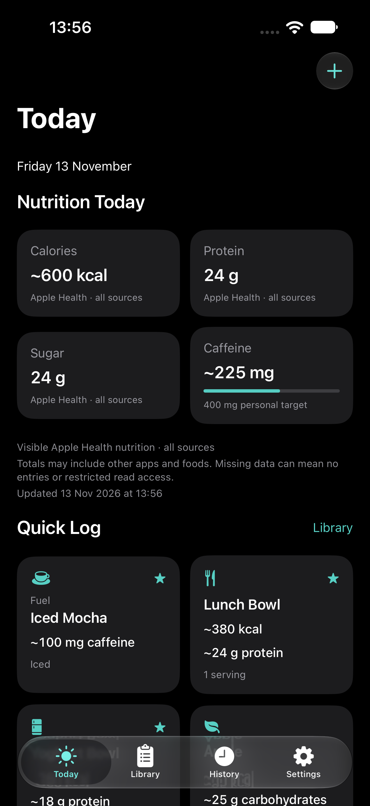

# Tally

A native iPhone nutrition utility for saving your usual foods and drinks and logging their known nutrition to Apple Health.

## What it does

- Save reusable foods and drinks with favourites, brands, serving sizes, notes, and optional nutrition.
- Find a saved item with search, category filters, five sort orders, and ranked Quick Log cards.
- Review an item and its time before logging, or use Quick Add for a one-off entry.
- Choose calorie, protein, sugar, and caffeine summaries on Today, with recent Health history and an optional seven-day caffeine chart.
- Export and import the local template library as JSON.

Supported nutrition: caffeine (mg), energy (kcal), sugar, carbohydrates, protein, total fat, saturated fat, and fibre (g). **Blank means unknown; zero is a real value.** Tap `~` beside a nutrition field to mark it as estimated.

## Preview

Local Simulator screenshots with synthetic test data, not personal Health history.

| Light | Dark |
| --- | --- |
|  |  |

## Getting started

1. Open `Tally.xcodeproj` in Xcode 27.0 or later. The project uses the installed iOS 27 SDK and requires iOS 27.0 or later.
2. Select your Apple development team if necessary. HealthKit and its read/write purpose descriptions are already configured.
3. Build and run on an iPhone. Add a food or drink in **Library**, then tap it to review its nutrition and log time.
4. Choose Health permissions when requested. Logging requires write access for every known nutrient in that entry; a denied field fails the entire event without saving partial nutrition.

In Debug builds, **Settings → Development → Add Development Examples** inserts six synthetic food and drink templates once. These are demonstration values, not a nutrition reference. The original once-only marker is retained, so users who previously added examples do not receive another batch. Unknown nutrition stays blank. Presets are never inserted automatically in a normal launch and are compiled out of Release builds.

## Food and drink templates

A name is the only required template field. Serving size is free text (for example, “1 bowl” or “330 ml”); liquid volume and serving style are optional. New items start with no specified style. Food categories sit alongside the existing coffee, tea, pod, and bottled-drink options.

Calories, protein, sugar, and caffeine are immediately accessible in the editor. Carbohydrates, fats, and fibre are under **More Nutrition**. Cards show the known values that best describe each item, so a protein-only food never needs a caffeine placeholder. Configure the Today cards in **Settings → Nutrition on Today**. Hiding caffeine also hides its weekly chart; the personal tracking target remains available in Settings.

Existing libraries and version-1 JSON exports continue to work. The internal `SavedDrink` type and the JSON `drinks` key retain their original names to preserve compatibility; exported files are now named **Tally Library**. Existing logged drink names and Apple Health metadata remain unchanged.

## Data and privacy

Reusable food and drink templates live only in this device’s SwiftData store. Actual consumption is saved as independent HealthKit samples and queried from Apple Health. Editing or deleting a template never changes historical samples.

Today’s totals and history show **visible Apple Health nutrition from all sources**, including other apps and foods. They are not presented as drinks-only totals. Empty results cannot establish whether read permission was denied. Limited-history access is respected. Pull to refresh, or return to Tally after changing data or permissions in Health.

The default 400 mg caffeine target is a personal tracking preference, not a medical recommendation. Change it in Settings.

Tally contains no networking, backend, accounts, ads, analytics, or cloud template syncing. Apple Health’s own system-managed sync and backup settings are controlled separately by the user. A JSON export is an explicit user-directed Files action and contains templates only, excluding consumption dates, usage counts, and Health history. Imports add missing UUIDs and keep existing templates unchanged.

See [the data and architecture notes](docs/DATA_AND_ARCHITECTURE.md) for event grouping, save boundaries, and the JSON contract, and [local verification](docs/VERIFICATION.md) for the initial app checks. The [general nutrition verification](docs/ISSUE_2_VERIFICATION.md) records the latest commands, results, and remaining manual Health/VoiceOver checks.

## Development

Swift 6, SwiftUI, SwiftData, HealthKit, and Swift Charts. Apple frameworks only; there are no third-party package dependencies.

Run all verification locally with isolated DerivedData under `/private/tmp`. No GitHub Actions workflow is configured. UI tests use an in-memory library and a synthetic Health adapter, never the real Health store.

The neutral plate-and-tally icon has reproducible native drawing source in [Design/RenderAppIcon.swift](Design/RenderAppIcon.swift).
