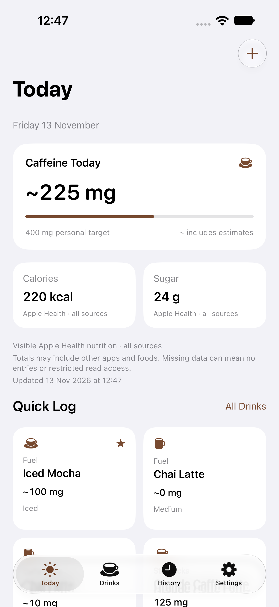

# Tally

A native iPhone nutrition utility for saving your usual foods and drinks and logging their known nutrition to Apple Health.

## What it does

- Save reusable foods and drinks with favourites, brands, serving sizes, notes, and optional nutrition.
- Mark items **Homemade** and collect their ingredients and methods in **Library → Recipe Book**.
- Find a saved item with search, category filters, five sort orders, and ranked Quick Log cards. Archive items you no longer use and restore them from the Library’s Archived view.
- Review an item and its time before logging, or use Quick Add for a one-off entry.
- Choose calorie, protein, sugar, caffeine, and sodium summaries on Today.
- Open **History → Trends** for seven- or 30-day charts for every nutrient. Select a day to see its total and contributing Health entries.
- Compare nine daily nutrient totals with editable adult references, personal targets, or maximums, with a full Daily Intake breakdown. Tap a nutrient card to see the visible entries contributing to today’s total.
- Optionally sync saved templates through your private iCloud storage, with offline edits and explicit account-switch control.
- Export independent JSON snapshots to Files/iCloud Drive; import missing items or restore older snapshots as new copies.

Supported nutrition: caffeine and sodium (mg), energy (kcal), sugar, carbohydrates, protein, total fat, saturated fat, and fibre (g). Sodium can also be entered as salt (g). **Blank means unknown; zero is a real value.** Tap `~` beside a nutrition field to mark it as estimated.

## Preview

Local Simulator screenshots with synthetic test data, not personal Health history.

| Light | Dark |
| --- | --- |
|  |  |

## Getting started

1. Open `Tally.xcodeproj` in Xcode 27.0 or later. The project uses the installed iOS 27 SDK and requires iOS 27.0 or later.
2. Select your Apple development team. HealthKit, iCloud/CloudKit, Push Notifications, remote-notification background mode, and Health purpose descriptions are configured. Create/select `iCloud.gale-k.Tally` in Signing & Capabilities and regenerate provisioning for these capabilities. See [iCloud setup](docs/ICLOUD_SYNC.md#developer-setup).
3. Build and run on an iPhone. Add a food or drink in **Library**, then tap it to review its nutrition and log time.
4. Choose Health permissions when requested. Tally only sends positive nutrient amounts to Apple Health. Each entry needs at least one positive amount and write access for every nutrient it sends.

In Debug builds, **Settings → Development → Add Development Examples** inserts six synthetic food and drink templates once. These are demonstration values, not a nutrition reference. The original once-only marker is retained, so users who previously added examples do not receive another batch. Unknown nutrition stays blank. Presets are never inserted automatically in a normal launch and are compiled out of Release builds.

## Food and drink templates

A name is the only required template field. Serving size is free text (for example, “1 bowl” or “330 ml”); amount and serving style are optional. **Amount** can be entered in **ml** or **g**; changing the unit keeps the entered number without converting between volume and weight. Serving styles include **Cold** separately from **Iced**. New items start with no specified style. Food categories sit alongside the existing coffee, tea, pod, and bottled-drink options.

In **Add Item** or **Edit Item**, turn on **Homemade**, then tap **Add Recipe** to open the recipe editor. Enter ingredients, a method, or both. Tap **Done** to return to the item, then **Save**. Open **Library → Recipe Book** to find recipes by name or ingredient, read them, and edit their items. The book keeps recipes from archived items and items you later unmark as Homemade. To remove a recipe while keeping its item, clear both recipe fields and save. Deleting the item also deletes its recipe.

Calories, protein, sugar, and caffeine are immediately accessible in the editor. Carbohydrates, fats, fibre, and sodium/salt are under **More Nutrition**. Choose **Sodium (mg)** or **Salt (g)** to match the label; switching converts the entered amount. Salt uses the [food-label conversion](https://www.foodstandards.gov.scot/consumer-advice/healthy-eating/balanced-diet/understanding-nutrients/salt): 1 g salt = 400 mg sodium. Tally stores and logs one sodium value to Apple Health, and saved items reopen in sodium mg. First use requests any newly needed Health write permission.

Cards show the known values that best describe each item, so a protein-only food never needs a caffeine placeholder. Configure the Today cards in **Settings → Nutrition on Today**. **Show Sodium** is off until enabled. **View Trends** opens History from Today, and **View trend** on a contribution page opens the corresponding nutrient.

Existing libraries and version-1 JSON exports continue to work. The internal `SavedDrink` type and the JSON `drinks` key retain their original names to preserve compatibility; exported files are now named **Tally Library**. Existing logged drink names and Apple Health metadata remain unchanged.

## Data and privacy

Reusable food and drink templates remain available in this device’s SwiftData store. Optional iCloud sync sends template details, including nutrition, recipes, notes, favourites, and archive state, to your private CloudKit database after confirmation in Settings. Recipes are also included in library snapshots. Actual consumption is saved as independent HealthKit samples and queried from Apple Health. Editing, archiving, or deleting a template never changes historical samples.

Today’s totals and history show **visible Apple Health nutrition from all sources**, including other apps and foods. They are not presented as drinks-only totals. Empty results cannot establish whether read permission was denied. Limited-history access is respected. Nutrient breakdowns include visible entries from all sources; some may have no food name. Pull to refresh, or return to Tally after changing data or permissions in Health.

**History → Trends** remembers your last nutrient on this device. The daily average uses completed days with visible amounts, including recorded zeroes. Gaps indicate missing visible data. Today's total is labelled **today so far** and is excluded from the average.

Configure **Settings → Daily Intake** to edit, disable, or individually reset the UK Adult Reference Preset. Today shows the selected comparison, percentage, and difference; **Daily Intake Breakdown** includes all nine comparisons even when dashboard cards are hidden. Percentages continue beyond 100%. Protein and fibre do not become upper limits. Missing Health data never becomes a zero or a full remaining allowance, and estimated amounts retain `~`. Differences use visible totals only.

The starting values are 2,000 kcal, 50 g protein, 260 g carbohydrates, 70 g total fat, 20 g saturated fat, and 90 g **total sugars** ([NHS Scotland adult food-label references](https://mydiabetesmyway.scot.nhs.uk/resources/internal/food-labels/#reference-intakes)); 30 g fibre ([Food Standards Scotland](https://www.foodstandards.gov.scot/consumer-advice/healthy-eating/balanced-diet/understanding-nutrients/fibre)); and a 400 mg personal caffeine maximum ([EFSA healthy-adult guidance](https://www.efsa.europa.eu/en/topics/topic/caffeine)). These are general adult starting points; individual needs vary. Food-label references are not universal targets or safe maximums. Caffeine guidance differs for pregnancy and breastfeeding; your existing personal caffeine value is preserved. Edited goals are personal targets; edited maximums are personal tracking limits.

Tally's total sugars cannot distinguish free sugars, so it is not compared against the [NHS 30 g free-sugars guidance](https://www.nhs.uk/live-well/eat-well/food-types/how-does-sugar-in-our-diet-affect-our-health/). Daily settings stay local, are excluded from snapshots/sync, and never change saved nutrition, Health permissions, or history. Sodium has a default adult daily maximum of 2,400 mg, equivalent to 6 g salt ([Food Standards Scotland](https://www.foodstandards.gov.scot/consumer-advice/healthy-eating/balanced-diet/understanding-nutrients/salt)). Edit the same value as sodium or salt; it is stored as sodium. Cards use “Daily target” or “Daily maximum”; sugar and fat maximums are tracking comparisons based on food-label references, not universal medical limits.

Tally has no custom backend, Tally account, ads, or analytics. The only app-managed network transfer is optional template sync through Apple CloudKit. Preferences, convenience usage counts/dates, and Health permission state stay local. Apple Health’s own system-managed sync and backup settings are controlled separately by the user.

Live sync propagates edits and deletions; it is not an independent backup. **Settings → Backups & Restore → Export Library Snapshot** creates a manual version-1 JSON snapshot. Choose iCloud Drive in Files to keep a recovery copy there. Imports add missing UUIDs and keep existing templates unchanged. **Restore Snapshot as New Copies** creates fresh identities after confirmation, allowing recovery of older versions without overwriting current templates. These actions exclude consumption dates, usage counts, and Health history. See [iCloud sync and recovery](docs/ICLOUD_SYNC.md) for conflicts, account changes, and recovery steps.

The [daily intake verification](docs/DAILY_INTAKE_VERIFICATION.md) records the target-setting, compatibility, appearance, local test, and physical-device checks.

See [the data and architecture notes](docs/DATA_AND_ARCHITECTURE.md) for event grouping, save boundaries, and the JSON contract, and [local verification](docs/VERIFICATION.md) for the initial app checks. The [general nutrition verification](docs/ISSUE_2_VERIFICATION.md) records the theme-change checks. [Sodium/salt verification](docs/SODIUM_VERIFICATION.md) records this addition’s local checks and remaining manual limits. [iCloud verification](docs/ISSUE_1_VERIFICATION.md) records the current local tests, successful signed iPhone installation and launch, and the later [live CloudKit and iCloud Drive checks](docs/LIVE_ICLOUD_VERIFICATION.md), including their remaining device/UI limits.

## Development

Swift 6, SwiftUI, SwiftData, CloudKit (`CKSyncEngine`), HealthKit, and Swift Charts. Apple frameworks only; there are no third-party package dependencies.

Run all verification locally with isolated DerivedData under `/private/tmp`. No GitHub Actions workflow is configured. UI tests use an in-memory library, a synthetic Health adapter, and disabled CloudKit access; they never contact the real Health store or iCloud.

Optional live verification uses uniquely owned Development CloudKit scratch resources and a synthetic iCloud Drive snapshot. It is explicitly gated and skipped by ordinary tests; see [live verification](docs/LIVE_ICLOUD_VERIFICATION.md) before running the helpers.

The neutral plate-and-tally icon has reproducible native drawing source in [Design/RenderAppIcon.swift](Design/RenderAppIcon.swift).
